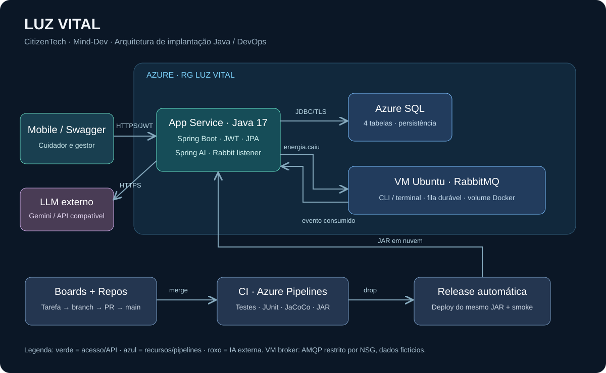
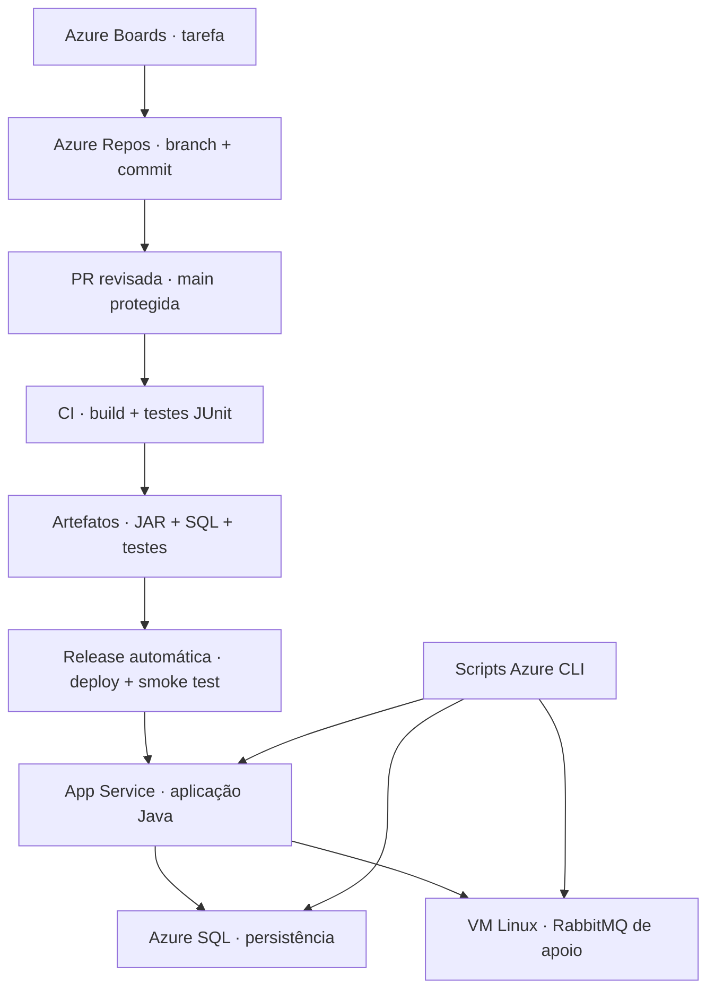

# Luz Vital · DevOps Tools & Cloud Computing

**Global Solution 2026/2 · CitizenTech · Grupo Mind-Dev · 2TDS**

Este repositório contém a entrega de **DevOps Tools & Cloud Computing**: provisionamento em nuvem com Azure CLI, rastreabilidade no Azure Boards/Repos, proteção da branch principal, integração contínua com testes e artefatos e deploy automático por uma pipeline de Release.

A aplicação Java Luz Vital é a carga de trabalho usada para comprovar esse fluxo. Ela gerencia pacientes eletrodependentes, aparelhos e ocorrências de falta de energia. Os requisitos da disciplina de Java foram usados como referência para construir a aplicação; o objetivo desta entrega é demonstrar sua **construção, teste, publicação e operação em nuvem com Azure DevOps**.

## Equipe

| Integrante | RM |
|---|---|
| Bruno Ferreira | 563489 |
| Gabriel Robertoni Padilha | 566293 |
| Hebert Lopes dos Santos | 563192 |
| Nicolas Monteiro Ramiro | 562380 |
| Marcus Vinícius Vila Nova da Silva | 558771 |

## Fluxo da entrega DevOps

1. Criar os recursos de nuvem por scripts Azure CLI versionados.
2. Criar uma tarefa no Azure Boards e uma branch vinculada.
3. Alterar código Java e fazer commit associado ao Work Item.
4. Abrir PR para `main`, cumprir revisão e concluir o merge.
5. Disparar automaticamente a CI: compilar, testar e publicar o pacote.
6. Disparar automaticamente a Release a partir do artefato da CI.
7. Comprovar a alteração publicada e executar CRUDs com SELECT no banco em nuvem.
8. Concluir a tarefa com os vínculos de branch, commits e PR.

## Arquitetura macro DevOps





A aplicação fica no **App Service** e o banco no **Azure SQL**, opções permitidas pelo enunciado. A VM Linux é usada como terminal de apoio e broker RabbitMQ. H2 serve somente aos testes/desenvolvimento e não é o banco da entrega.

O broker usa volume persistente e AMQP restrito por NSG aos IPs de saída do App Service. O exemplo acadêmico não configura TLS no broker e deve usar dados fictícios. A API pública usa HTTPS e a conexão com Azure SQL usa TLS. Detalhes operacionais: [Azure e VM](docs/AZURE-E-VM.md).

## Componentes e evidências

| Componente | Implementação/evidência |
|---|---|
| Infraestrutura como código | Scripts Azure CLI em `/scripts` |
| Versionamento | Projeto privado Git no Azure Repos |
| Rastreabilidade | Tarefa, branch, commit `AB#ID` e PR vinculados |
| Governança da main | Revisor obrigatório, Work Item obrigatório e revisor padrão identificado com RM |
| CI | `azure-pipeline.yml`, acionada pela atualização protegida da main após merge |
| Testes | JUnit/MockMvc, resultados em Tests e cobertura JaCoCo |
| Artefatos | `drop`: JAR e SQL; `testes-junit`: relatórios |
| Release | `azure-release.yml`, disparada pela conclusão bem-sucedida da CI |
| Deploy | Mesmo JAR publicado pela CI, sem recompilar na Release |
| Validação pós-deploy | Smoke test HTTPS de saúde e versão |
| Banco | Azure SQL; DDL em `scripts/script-bd.sql` |
| Persistência | CRUD das quatro tabelas com SELECT direto no Azure SQL |
| Acesso do professor | Basic na organização e Project Administrators no projeto |

As políticas são configurações do Azure DevOps e devem ser aplicadas e mostradas na interface. O YAML não impede sozinho push direto ou bypass por administrador. A primeira execução manual pode ser usada no ensaio; o vídeo final deve mostrar CI e Release automáticas após a PR.

## Guias de execução

| Etapa | Guia |
|---|---|
| Subir os arquivos no Git | [INICIO-AQUI.md](INICIO-AQUI.md) |
| Provisionar recursos e preparar a VM | [AZURE-E-VM.md](docs/AZURE-E-VM.md) |
| Configurar Boards, Repos, políticas e pipelines | [AZURE-DEVOPS.md](docs/AZURE-DEVOPS.md) |
| Conferir todos os requisitos da disciplina | [REQUISITOS.md](docs/REQUISITOS.md) |
| Gravar o fluxo e os CRUDs | [ROTEIRO-VIDEO.md](docs/ROTEIRO-VIDEO.md) |
| Estudar para apresentação presencial | [APRESENTACAO-DEVOPS.md](docs/APRESENTACAO-DEVOPS.md) |
| Consultar validação já executada | [VALIDACAO.md](docs/VALIDACAO.md) |
| Usar os endpoints da aplicação | [API.md](docs/API.md) |

## Organização do repositório

```text
azure-pipeline.yml       Pipeline CI: build, testes e artefatos
azure-release.yml        Pipeline Release: download, deploy e smoke test
scripts/                 Azure CLI, instalação, DDL e SELECTs
dockerfiles/             Dockerfile opcional da aplicação
src/main/                Código-fonte da aplicação Java implantada
src/test/                Testes automáticos executados na CI
postman/                 Requisições para demonstrar os CRUDs
docs/                    Arquitetura, configuração, vídeo e evidências
compose.yml              Broker para ensaio local
pom.xml                  Build Maven da aplicação
```

A hospedagem padrão usa JAR em App Service, sem ACR/ACI. O Dockerfile é uma alternativa incluída; não é usado pela Release padrão. O RabbitMQ da VM roda em container e sua criação está em `scripts/04-iniciar-broker-vm.sh`.

## CI e Release

Cadastre duas definições no Azure Pipelines:

| Nome obrigatório | YAML | Disparo |
|---|---|---|
| `luz-vital-ci` | `/azure-pipeline.yml` | Push da main após merge por PR protegida |
| `luz-vital-release` | `/azure-release.yml` | Conclusão bem-sucedida da CI na main |

Crie a conexão Azure Resource Manager `sc-luz-vital`, preferencialmente com identidade federada, e o grupo de variáveis `luz-vital-prod` com `RESOURCE_GROUP` e `WEBAPP`. Autorize as duas definições e os recursos necessários durante o ensaio. Se não houver paralelismo Microsoft-hosted, configure um agente próprio conforme o guia.

CI executa `mvn clean verify`, publica JUnit, JaCoCo e os artefatos. Release baixa o pacote da execução disparadora, implanta o JAR e valida `/actuator/health` e `/api/v1/versao`. A demonstração altera `VersaoController.java`, permitindo comprovar a mudança diretamente na URL pública.

## Aplicação usada para demonstrar o deploy

Java 17, Spring Boot, Maven, JPA, JWT e Swagger. Tabelas: `usuarios`, `pacientes`, `aparelhos` e `ocorrencias`. A API permite demonstrar criação, leitura, atualização e exclusão com relações reais no banco. A aplicação também possui Spring AI e RabbitMQ, mas a apresentação deve concentrar-se na operação da solução e no fluxo DevOps.

A chave do LLM e a integração no Mobile **não são necessárias para concluir o roteiro de DevOps**. `AI_ENABLED=false` mantém a funcionalidade de IA explicitamente desativada sem impedir CRUDs, CI ou deploy. O RabbitMQ integra a infraestrutura escolhida e precisa estar acessível para o health check final.

- Swagger em nuvem: `https://SEU_WEBAPP.azurewebsites.net/swagger-ui/index.html`.
- Versão publicada: `https://SEU_WEBAPP.azurewebsites.net/api/v1/versao`.
- Saúde: `https://SEU_WEBAPP.azurewebsites.net/actuator/health`.

Importe [a coleção Postman](postman/Luz-Vital.postman_collection.json) e [o ambiente](postman/Luz-Vital.postman_environment.json). Preencha URL e credenciais sem compartilhar o ambiente preenchido.

## Testes e verificação local

Pré-requisitos: JDK 17 e Maven 3.6.3+ (validado com 3.9.9).

```bash
mvn -B -ntp clean verify
```

Foram executados **11 testes, sem falhas ou erros**. A execução usa H2 e um provedor LLM simulado; não exige chave paga nem broker externo. Relatórios JUnit ficam em `target/surefire-reports`; cobertura em `target/site/jacoco/index.html`. Os mesmos testes são executados na CI.

Para iniciar a aplicação em ensaio local, preencha o modelo de ambiente, inicie o broker com Compose e siga `INICIO-AQUI.md`. A avaliação final usa os serviços em nuvem.

## Variáveis e segredos

| Variável | Uso |
|---|---|
| `SPRING_PROFILES_ACTIVE` | `local` em desenvolvimento; `prod` em nuvem |
| `DB_URL`, `DB_USER`, `DB_PASSWORD` | JDBC Azure SQL com TLS |
| `JWT_SECRET` | Segredo de assinatura, mínimo 32 bytes |
| `BOOTSTRAP_EMAIL`, `BOOTSTRAP_PASSWORD` | Primeiro gestor; remover após cadastro inicial |
| `RABBIT_HOST/PORT/USER/PASSWORD/SSL` | Broker |
| `MESSAGING_ENABLED` | `true` na entrega; `false` somente testes isolados |
| `AI_ENABLED`, `AI_API_KEY` | Ativação e chave do LLM |
| `AI_BASE_URL`, `AI_COMPLETIONS_PATH`, `AI_MODEL` | Provedor e modelo |
| `RESOURCE_GROUP`, `WEBAPP` | Grupo de variáveis `luz-vital-prod` da Release |

Arquivos `.env*` locais são ignorados, exceto modelos `.example`. Não filme telas de segredos, tokens completos ou arquivos de ambiente. Dados de saúde são sensíveis; endereços também exigem proteção. Use somente dados fictícios na avaliação. DDL inicial é idempotente, mas não substitui migrações versionadas futuras.

## Entrega e demonstração

O vídeo deve ser contínuo, narrado por voz e ter pelo menos 720p. Mostre README/arquitetura, recursos provisionados, tarefa nova, branch, alteração em código-fonte, PR/merge, CI completa, testes/artefatos, Release automática, alteração publicada, CRUDs e SELECTs, e tarefa concluída com vínculos.

Demonstre as quatro tabelas para cobrir a redação mais exigente do enunciado. Após cada POST, PUT e DELETE, rode `scripts/09-select-banco.sh`. GET demonstra leitura da API; a persistência deve ser comprovada por SELECT no banco remoto.

O PDF final deve se chamar `Mind-Dev_rm563489.pdf`, conter grupo/integrantes/RMs, link da organização Azure DevOps e link do vídeo YouTube. A apresentação presencial cobre aplicação funcionando, arquitetura e construção/utilização do Azure DevOps.

## Status e links reais

| Item | Status |
|---|---|
| Fontes, scripts, documentação e YAML | Preparados |
| Build e testes locais | Validados; consulte `docs/VALIDACAO.md` |
| Organização/projeto Azure DevOps | Pendente de criação/configuração |
| Recursos Azure | Pendentes de provisionamento na assinatura |
| Execução CI e Release em Azure DevOps | Pendente de configuração e validação real |
| Acesso do professor | Pendente de e-mail confirmado e concessão |
| Organização Azure DevOps | **PREENCHER LINK REAL** |
| Swagger em nuvem | **PREENCHER LINK REAL** |
| Vídeo YouTube | **PREENCHER LINK REAL** |

O pacote preparado não comprova sozinho as etapas de nuvem. Nenhum recurso, execução remota ou link de evidência é apresentado como concluído antes de ser validado na conta do aluno.
