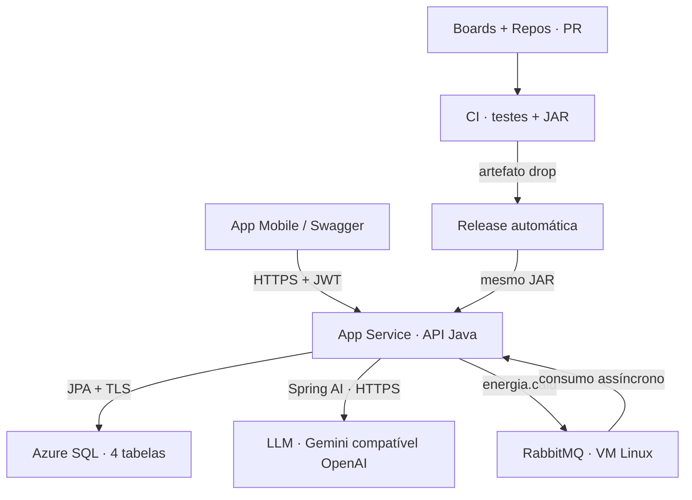

# Luz Vital · Mind-Dev

**Quando a luz cai, o socorro chega primeiro a quem tem menos bateria.**

Backend Java da CitizenTech Luz Vital — Global Solution FIAP 2026/2, turma 2TDS. Organiza pacientes eletrodependentes, seus aparelhos e ocorrências de falta de energia; oferece ao gestor uma fila pela autonomia restante e gera um plano logístico com Spring AI.

## Equipe

| Integrante | RM |
|---|---|
| Bruno Ferreira | 563489 |
| Gabriel Robertoni Padilha | 566293 |
| Hebert Lopes dos Santos | 563192 |
| Nicolas Monteiro Ramiro | 562380 |
| Marcus Vinícius Vila Nova da Silva | 558771 |

## Comece por aqui

1. Leia [INICIO-AQUI.md](INICIO-AQUI.md) para subir os arquivos no Git e executar localmente.
2. Siga [o guia Azure e VM](docs/AZURE-E-VM.md) para provisionar os recursos.
3. Configure [Boards, Repos e Pipelines](docs/AZURE-DEVOPS.md).
4. Importe a coleção [Postman](postman/Luz-Vital.postman_collection.json) e o [ambiente](postman/Luz-Vital.postman_environment.json).
5. Use [o roteiro de vídeo](docs/ROTEIRO-VIDEO.md) e [a matriz dos requisitos](docs/REQUISITOS.md).
6. Consulte [a validação executada](docs/VALIDACAO.md) e [a explicação das classes Java](docs/APRESENTACAO-JAVA.md).

**O pacote contém código e configuração. Recursos Azure, credenciais, convite ao professor, repositórios remotos, execução real do LLM/broker em nuvem, integração no app Mobile e gravação são etapas externas a executar.** Não há URLs de implantação ou evidências inventadas.

## Problema e proposta

Pessoas que usam equipamentos elétricos para suporte à vida podem ficar vulneráveis em apagões. O Luz Vital centraliza o cadastro e registra o instante declarado da queda, usando a menor autonomia informada entre os aparelhos para ordenar ocorrências abertas. No empate em minutos, pacientes com ventilador vêm primeiro, seguidos do instante de abertura. Essa é uma regra de protótipo que precisa de validação profissional; não é triagem clínica.

A fila é recalculada em cada consulta. O contador nunca fica negativo. Autonomia zero representa necessidade imediata de atenção. Os valores são declarados, não medidos por telemetria, e ficam congelados na abertura: editar um aparelho depois não altera o histórico daquela ocorrência. O plano de IA é preventivo/logístico e precisa ser revisado pela equipe responsável. O sistema não garante socorro e não substitui 192/193.

## Escopo implementado

- CRUD paginado de **usuários, pacientes, aparelhos e ocorrências**; três entidades centrais relacionadas, além da conta de acesso.
- DTOs, Bean Validation, erros padronizados com `@RestControllerAdvice` e códigos HTTP.
- Spring Security com JWT HS256 e papéis **CUIDADOR** e **GESTOR**; senha BCrypt; isolamento dos dados por cuidador.
- Spring AI com `ChatClient`, LLM configurável e resposta estruturada; plano vinculado ao paciente, salvo no banco e recuperável pelo Mobile.
- RabbitMQ: exchange durável, fila, publicação com confirmação, consumo assíncrono e fila de erros. Evento `energia.caiu`, sem dados pessoais na mensagem.
- Flag de evento pendente persistida na ocorrência: novas tentativas quando o broker volta; processamento idempotente pelo consumidor.
- Swagger/OpenAPI, health check, testes automáticos e cobertura JaCoCo.
- Scripts Azure CLI, DDL Azure SQL, CI e Release em definições separadas.

**Não implementado neste backend:** OCR da etiqueta, mapa/pontos voluntários, aplicativo Mobile completo, API .NET, MongoDB, notificações reais, plano offline no dispositivo e integrações com órgãos públicos. São partes do plano maior; não são apresentadas como funcionalidades concluídas. Há um adaptador de exemplo para o Mobile em `examples/mobile/`.

## Arquitetura macro




A VM é apoio Linux e broker. **Aplicação no App Service e banco no Azure SQL**, conforme opções de hospedagem do enunciado. H2 é usado somente em desenvolvimento/testes. A comunicação AMQP da configuração acadêmica usa rede restrita por NSG e dados fictícios; não há TLS no broker dessa VM. Para uso real, configure AMQPS com certificado válido (`RABBIT_SSL=true`, porta 5671), regras compatíveis e rede privada; não coloque dados reais neste protótipo.

## Tecnologias e organização

Java 17 · Spring Boot 3.5.15 · Spring Data JPA · Spring Security/OAuth2 Resource Server · Spring AI 1.1.8 · RabbitMQ · Maven · Azure SQL · H2 · OpenAPI · JUnit/MockMvc · JaCoCo.

```text
src/main/java/br/com/minddev/luzvital/  API, domínio, segurança, IA, mensageria
src/main/resources/                   configuração por ambiente
src/test/                             testes HTTP/JPA/segurança/Spring AI
scripts/                              Azure CLI, instalação, DDL e SELECTs
dockerfiles/                          Dockerfile opcional da API
postman/                              coleção CRUD + ambiente sem segredos
docs/                                 arquitetura e guias de entrega
examples/mobile/                      adaptador TypeScript para integrar no app
azure-pipeline.yml                    CI
azure-release.yml                     Release automática por conclusão da CI
compose.yml                           RabbitMQ local
```

## Rodar localmente

Pré-requisitos: JDK 17 e Maven 3.6.3+ (validado com 3.9.9), Docker com Compose para o broker. No Ubuntu VM há script de instalação.

```bash
cp .env.example .env
# Edite .env: JWT_SECRET (>=32 caracteres), BOOTSTRAP_PASSWORD (10..72), RABBIT_PASSWORD.
# Gere segredos com: openssl rand -hex 32
set -a
source .env
set +a
docker compose up -d
mvn clean verify
mvn spring-boot:run
```

Abra `http://localhost:8080/swagger-ui/index.html`. O perfil `local` usa H2 em memória e recria os dados a cada reinício. **Não é o banco da entrega.** Use `prod` com Azure SQL e execute previamente `scripts/script-bd.sql`; o Hibernate só valida o esquema nesse perfil.

O gestor inicial é criado apenas se `BOOTSTRAP_EMAIL` ainda não existir. Alterar `BOOTSTRAP_PASSWORD` depois não redefine a senha do usuário existente. Remova essas configurações de bootstrap do App Service após validar o primeiro acesso. Não há credenciais padrão válidas no código.

## Autenticação e permissões

1. `POST /api/v1/auth/registro`: cria apenas **CUIDADOR** (o papel não é recebido no DTO).
2. `POST /api/v1/auth/login`: devolve `accessToken`, `tokenType`, `expiresIn` e `papel`.
3. No Swagger, clique **Authorize** e cole o token puro. Em HTTP, use `Authorization: Bearer TOKEN`.
4. O gestor pode gerenciar usuários e visualizar todos os registros. O cuidador só acessa pacientes sob sua responsabilidade, incluindo aparelhos e ocorrências.

| Recurso | Cuidador | Gestor |
|---|---|---|
| Registro/login e versão | Público | Público |
| Pacientes/aparelhos | CRUD dos seus pacientes | CRUD geral |
| Ocorrências | Abrir, listar e consultar as suas | CRUD geral, encerrar e excluir |
| Fila de prioridade | 403 | Permitido |
| Plano de contingência | Gerar para seu paciente | Gerar para qualquer paciente |
| Usuários | 403 | CRUD |

Tokens expiram em 60 minutos, sem refresh token. Alteração de papel, senha ou exclusão não revoga imediatamente JWT já emitido; para invalidação global, rotacione `JWT_SECRET`. Não há recuperação de senha, MFA ou prontidão para produção.

## Contrato REST

Base: `/api/v1`. As listas recebem `page=0&size=20`, limite 100; retorno `content`, `totalElements`, `totalPages`, `number` e `size`. IDs são gerados pelo banco. Datas ISO-8601 em UTC (`Z`). IDs numéricos e chave idempotente persistidos pelo cliente.

| Método e rota | Finalidade |
|---|---|
| POST `/auth/registro` | Cadastro CUIDADOR |
| POST `/auth/login` | JWT |
| GET/POST `/usuarios` | Lista paginada/cria usuário (gestor) |
| GET/PUT/DELETE `/usuarios/{id}` | Consulta/atualiza/exclui usuário |
| GET/POST `/pacientes` | Lista paginada/cria paciente |
| GET/PUT/DELETE `/pacientes/{id}` | Consulta/atualiza/exclui paciente |
| POST `/pacientes/{id}/plano` | Gera e persiste plano com Spring AI |
| GET/POST `/aparelhos` | Lista paginada/cria aparelho |
| GET/PUT/DELETE `/aparelhos/{id}` | Consulta/atualiza/exclui aparelho |
| GET/POST `/ocorrencias` | Lista paginada/abre ocorrência |
| GET/PUT/DELETE `/ocorrencias/{id}` | Consulta/encerra/exclui ocorrência |
| GET `/ocorrencias/fila` | Prioridade recalculada (gestor) |
| GET `/versao` | Mensagem pública para simular alteração no vídeo |
| GET `/actuator/health` | Saúde da aplicação e dependências |

### JSONs essenciais

Registro/login:
```json
{"nome":"Cuidador fictício","email":"cuidador@example.com","senha":"PREENCHA_UMA_SENHA_FORTE"}
```
```json
{"email":"cuidador@example.com","senha":"PREENCHA_UMA_SENHA_FORTE"}
```

Paciente (`cuidadorId`: ID retornado pelo cadastro, não RM):
```json
{"nome":"Paciente fictício","endereco":"Rua de teste 100","telefone":"11999990000","cuidadorId":2}
```

Aparelho (`pacienteId`: ID retornado ao criar paciente):
```json
{"pacienteId":1,"modelo":"Ventilador de demonstração","tipo":"VENTILADOR","potenciaWatts":100,"autonomiaMinutos":120}
```
Tipos: `VENTILADOR`, `CONCENTRADOR`, `BOMBA`, `OUTRO`. Autonomia de 0 a 10080 minutos; potência de 1 a 100000 W.

Ocorrência (envie também `Idempotency-Key: UUID_GERADO_NO_CLIENTE`):
```json
{"pacienteId":1,"inicio":"2026-11-17T15:00:00Z","observacao":"Falta de energia informada pelo cuidador"}
```
Use o instante real declarado da queda, nunca uma data futura. Em reenvios, mantenha **o mesmo corpo e chave**; nova chave para novo pedido. O instante é normalizado a microssegundos, compatível com o banco. Repetição sequencial devolve o mesmo ID; chave com conteúdo diferente gera 409. Concorrência pode retornar 409: o cliente deve consultar e repetir com a mesma chave/corpo. O Azure SQL também impede duas ocorrências abertas para o mesmo paciente via índice filtrado.

Encerrar (gestor):
```json
{"status":"ENCERRADA","observacao":"Energia restabelecida; atendimento registrado"}
```
Não reabre ocorrência encerrada. Para excluir: encerrar e remover ocorrências → remover aparelhos → remover paciente → remover cuidador. Uma conta não pode excluir a si mesma.

Erros: 400 validação/JSON/cabeçalho; 401 JWT/credenciais; 403 papel ou propriedade; 404 registro; 409 dependência/duplicidade/conflito; 503 LLM indisponível. Exemplo:
```json
{"status":400,"codigo":"VALIDACAO","mensagem":"Revise os campos","timestamp":"2026-11-17T15:00:00Z","detalhes":["nome: não deve estar em branco"]}
```
Respostas do filtro de segurança usam os campos `status`, `codigo` e `mensagem`; não retornam stack trace ou detalhes internos.

## IA generativa aplicada ao fluxo

`POST /pacientes/{id}/plano` carrega os aparelhos daquele paciente e chama `ChatClient` do Spring AI. O LLM devolve um objeto `Plano` com `primeirasAcoes`, `pedirAjuda`, `preparacao` e `aviso`. O backend valida os campos e limite de tamanho, acrescenta aviso fixo e salva o JSON em `pacientes.plano_contingencia`. `GET /pacientes/{id}` devolve o último plano para o app armazenar offline. O backend não implementa o armazenamento no celular.

Configuração padrão: Gemini via endpoint compatível OpenAI, utilizando **Spring AI**, não uma chamada HTTP artesanal. Configure `AI_API_KEY`, `AI_ENABLED=true` e um `AI_MODEL` disponível para sua chave. Alternativa OpenAI: `AI_BASE_URL=https://api.openai.com`, `AI_COMPLETIONS_PATH=/v1/chat/completions` e modelo compatível com sua conta. Disponibilidade, quota e cobrança dependem do provedor. Nunca compartilhe a chave.

Sem chave/ativação, o endpoint retorna 503; não inventa resposta. Se o provedor falhar ou devolver estrutura inválida, o plano anterior permanece. Os testes usam um servidor LLM simulado e passam pelo `ChatClient` real, sem cobrança. O prompt reduz riscos, mas não garante correção factual: planos precisam de revisão humana.

## Mensageria e consistência

A ocorrência e a flag `eventoPendente=true` são persistidas na mesma transação. A cada 5 segundos o publisher tenta enviar `{"ocorrenciaId":123}` para `luz-vital.eventos`, routing key `energia.caiu`. Após confirmação do broker, limpa a flag. O consumidor assíncrono marca `eventoRecebido=true`; duplicatas não repetem a transição. A fila de erros `luz-vital.erros` recebe mensagens rejeitadas após tentativas.

Entrega **ao menos uma vez**, não exatamente uma. A fila do gestor consulta os dados já persistidos e não fica bloqueada pela indisponibilidade do broker. O evento registra processamento assíncrono para acompanhamento; não envia um chamado real à Defesa Civil. Uma transação concorrente do publisher/consumer pode ser repetida por controle otimista. O broker tem volume persistente na VM.

## Testes e CI/CD

```bash
mvn -B -ntp clean verify
```

JUnit em `target/surefire-reports`; cobertura em `target/site/jacoco/index.html`. Testes de integração HTTP/JPA com H2 verificam autenticação, autorização, isolamento, CRUD das quatro tabelas, validação, paginação, dependências, idempotência, fila e falhas da IA. O consumidor tem teste de repetição; o transporte RabbitMQ e Azure SQL devem ser validados na implantação real.

`azure-pipeline.yml`: roda no push da `main`; com políticas obrigatórias isso ocorre após merge por PR. Não possui disparo de PR nem build validation automático. Compila, testa e publica `drop` (JAR + SQL), JUnit e JaCoCo. `azure-release.yml`: outra pipeline, acionada pela conclusão bem-sucedida de `luz-vital-ci`, baixa o **artefato da execução disparadora**, faz deploy e smoke test HTTPS. Não recompila o código na Release.

## Variáveis e segredos

| Variável | Uso |
|---|---|
| `SPRING_PROFILES_ACTIVE` | `local` em desenvolvimento; `prod` em nuvem |
| `DB_URL`, `DB_USER`, `DB_PASSWORD` | JDBC Azure SQL com TLS |
| `JWT_SECRET` | Segredo de assinatura, mínimo 32 bytes |
| `BOOTSTRAP_EMAIL`, `BOOTSTRAP_PASSWORD` | Primeiro gestor; remover após cadastro inicial |
| `RABBIT_HOST/PORT/USER/PASSWORD/SSL` | Broker |
| `MESSAGING_ENABLED` | `true` na entrega; `false` somente testes isolados |
| `AI_ENABLED`, `AI_API_KEY` | Ativação e chave do LLM |
| `AI_BASE_URL`, `AI_COMPLETIONS_PATH`, `AI_MODEL` | Provedor e modelo |
| `RESOURCE_GROUP`, `WEBAPP` | Grupo de variáveis `luz-vital-prod` da Release |

Arquivos `.env*` locais são ignorados, exceto modelos `.example`. Não filme telas de segredos, tokens completos ou arquivos de ambiente. Dados de saúde são sensíveis; endereços também exigem proteção. Use somente dados fictícios na avaliação. DDL inicial é idempotente, mas não substitui migrações versionadas futuras.

## Links da entrega — preencher depois da implantação

- Organização Azure DevOps: **PENDENTE**
- Projeto privado Azure DevOps: **PENDENTE**
- API/Swagger em nuvem: **PENDENTE**
- Vídeo YouTube: **PENDENTE**
- App Mobile consumindo esta API: **PENDENTE**

## Referências técnicas

- [Spring AI e compatibilidade](https://github.com/spring-projects/spring-ai)
- [Spring AI — OpenAI Chat](https://docs.spring.io/spring-ai/reference/api/chat/openai-chat.html)
- [Gemini — compatibilidade OpenAI](https://ai.google.dev/gemini-api/docs/openai)
- [Java no App Service](https://learn.microsoft.com/azure/app-service/quickstart-java)
- [Deploy de JAR](https://learn.microsoft.com/azure/app-service/deploy-zip)
- [Gatilho entre pipelines](https://learn.microsoft.com/azure/devops/pipelines/process/pipeline-triggers)
